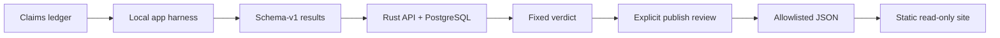

# ProjectBench

**Turn an engineering claim into a reproducible experiment and a reviewable verdict.**

Performance numbers and behavior claims are easy to write and hard to defend. ProjectBench connects each claim to a defined workload, validates the resulting observations, applies fixed verdict rules, and prepares a small public evidence document for review. The experiment, the result, and the limits of the conclusion stay together.

```text
Claim → local workload → schema-v1 results → deterministic verdict → reviewed evidence
```

The Rust API, PostgreSQL database, and run controls operate locally. The static evidence site reads only explicitly published JSON. **No evidence is published, and the public site is not deployed yet.**

## Try the complete path

You need Docker Engine with Compose v2, Make, and Git. From a clean checkout:

```sh
make demo
```

The command builds an isolated stack, sends five real HTTP requests to a bundled health endpoint, ingests schema-v1 results, and prints a verdict and next step. It needs no credentials for CanvasSync, Knowdex, or Gemini and sends no traffic to their production services.

| Local endpoint | Purpose |
| --- | --- |
| [127.0.0.1:4174](http://127.0.0.1:4174) | Read-only evidence site; shows its empty state until evidence is published. |
| [127.0.0.1:18080](http://127.0.0.1:18080) | Operator API, bound to loopback in the demo stack. |

Run `make demo-down` to stop this stack. The dedicated Compose project keeps its database volume. See the [quickstart](docs/quickstart.md) for configuration and reset instructions. The bundled health check demonstrates the ingest-to-verdict workflow; it is not an application performance benchmark.

## What ProjectBench does

| Stage | Output | Check |
| --- | --- | --- |
| Define | A claim with a metric, workload, baseline or expected behavior, repetitions, and source. | The claims ledger rejects invalid IDs and incomplete experiment definitions. |
| Measure | One schema-v1 result per accepted observation. | Results carry variant, workload, commit, container images, environment, CPU usage, and limitations. |
| Evaluate | A verdict per workload and a next step. | Rules compare medians and ranges, check environment equality and generator load, and never ask an AI model to choose a verdict. |
| Publish | An evidence index and claim JSON for the static site. | An explicit operator action writes only allowlisted fields; unpublished rows and operator data stay out. |

Comparative verdicts use the configured repetition count, median difference, min–max spread, matching environments, and a 70% generator CPU validity gate. If a range is wider than the median gap, the comparison is inconclusive. Behavior verdicts check the observed metric against a declared minimum. Outcomes include **verified**, **revised**, **conditional**, **not supported**, and **inconclusive**. The rules and their limitations are documented in the [methodology](docs/methodology.md).

## Current claim status

The measurements below are **local experiment findings, not published ProjectBench evidence**. Their accepted raw sample files are not in this checkout, so the evidence index and claim pages remain absent.

| Claim | Local finding | Conclusion |
| --- | --- | --- |
| CanvasSync cold joins | Compared a direct PostgreSQL read on join with a warm Redis snapshot for rooms of 100, 1,000, and 5,000 shapes. | All three workloads are inconclusive under the predeclared range rule. The historical path did not poll the database; a general 60% reduction is unsupported. [Experiment and fairness review](https://github.com/Krishna-Mehta-135/Canvassync/pull/86) |
| Knowdex coalescing | With five simultaneous typists, outbound update frames per receiver fell from 100 to 20 (80%). One typist and the AI stream had 0% median reduction; the paste run failed its CPU validity gate. | The 80% result applies only to the five-typist local workload. The broad 90% claim is unsupported. [Results and fairness review](https://github.com/Krishna-Mehta-135/Knowdex/pull/53) |
| AI behavior and token usage | Fallback, concurrent streaming, and real API token accounting have no accepted W6 results. | These ledger entries remain **Measuring**. [W6 status](docs/w6-ai-claim-status.md) |

The [publication checkpoint](docs/evidence-publication-checkpoint.md) records the proposed evidence set and the raw-result, privacy, visual-review, and owner-review gates. No result is reconstructed from a summary table.

## Architecture



The local API validates and stores results, computes verdicts, and transforms approved data into a separate evidence shape. The static site has no write controls and does not need the API or database at runtime. The [code tour](docs/code-tour.md) follows the implementation through those boundaries.

## Extend the system

A new project provides a harness that writes schema-v1 results and an entry in `claims/claims.yaml`. Run the workload locally, ingest the accepted files, inspect the verdict, and review the generated evidence before publication. Start with [add a project](docs/add-a-project.md), [write a harness](docs/write-a-harness.md), and the [result schema](docs/result-schema.md).

## Documentation

- [Quickstart](docs/quickstart.md) · [Concepts](docs/concepts.md) · [Methodology](docs/methodology.md)
- [Architecture](docs/architecture.md) · [Code tour](docs/code-tour.md) · [Local deployment](docs/local-deployment.md)
- [Safety model](docs/safety.md) · [Evidence publication checkpoint](docs/evidence-publication-checkpoint.md)

ProjectBench is released under the [MIT license](LICENSE).
