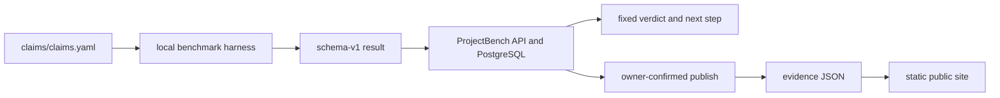

# ProjectBench

ProjectBench connects an engineering claim to a controlled experiment, a fixed verdict, and the evidence behind it.

**Built by [Krishna Mehta](https://github.com/Krishna-Mehta-135).**

**Screenshot:** A browser-reviewed product screenshot is pending. The public build currently opens with an honest empty state until evidence is approved for publication.

**Live site:** Not deployed yet. The operator API and PostgreSQL are local-only.

## Evidence status

- **CanvasSync cold joins:** The historical baseline was one direct PostgreSQL read on join. The local 100-, 1,000-, and 5,000-shape comparisons were inconclusive under ProjectBench's predeclared range rule. The original DB-poll and 60% claims are unsupported.
- **Knowdex coalescing:** Five simultaneous typists produced 80% fewer outbound update frames per receiver (100 to 20) in a local benchmark. One typist and the AI stream had 0% median reduction; the paste run was invalid. The broad 90% claim is unsupported.
- **AI claims:** Two-model fallback, concurrent streaming, and real API token usage remain measuring. No AI result is published.

The accepted W3/W4 sample files are absent from this checkout. No `evidence/` index or claim JSON has been published. See the [publication checkpoint](docs/evidence-publication-checkpoint.md) for the proposed evidence set and review gates.

## What ProjectBench is

ProjectBench stores claims, accepts strict schema-v1 benchmark results, computes deterministic verdicts, and can publish allowlisted evidence JSON. Experiments run against local Docker services. Each result carries its workload, repetitions, environment, limits, commit, and limitations.

ProjectBench is not production monitoring, an independent audit, a load generator for arbitrary targets, or an AI system that invents or revises measurements. The existing k6 run control plane is retained for local review; the week-one path is claims-first.

## Quickstart

Requirements: Docker Engine with Compose v2, Make, and Git. From a clean checkout:

```sh
make demo
```

The command starts an isolated ProjectBench demo stack, checks a bundled local HTTP endpoint five times, ingests each observed result, computes the verdict, and prints it. Browse the public evidence site at [http://127.0.0.1:4174](http://127.0.0.1:4174). It shows the empty state because the demo does not publish evidence. The local API is available at [http://127.0.0.1:18080](http://127.0.0.1:18080).

The default token is local-only and the API port is loopback-bound. To customize ports or the token, copy `.env.example` to `.env` and edit it. Stop only this demo stack with:

```sh
make demo-down
```

The demo uses its own Compose project (`projectbench-demo`) and keeps its database volume when stopped. Use `docker compose -p projectbench-demo down -v` only if you also want to remove the demo database.

## How it works



## Documentation

- [Quickstart](docs/quickstart.md)
- [Concepts](docs/concepts.md)
- [Add a project](docs/add-a-project.md)
- [Write a harness](docs/write-a-harness.md)
- [Result schema](docs/result-schema.md)
- [Methodology](docs/methodology.md)
- [Architecture](docs/architecture.md)
- [Local deployment](docs/local-deployment.md)
- [Safety](docs/safety.md)
- [Evidence publication checkpoint](docs/evidence-publication-checkpoint.md)
- [W6 AI claim status](docs/w6-ai-claim-status.md)
- [Measured claim wording](docs/w10-proposed-wording.md)
- [Week-one plan](docs/plan-v2-claims-first.md)
