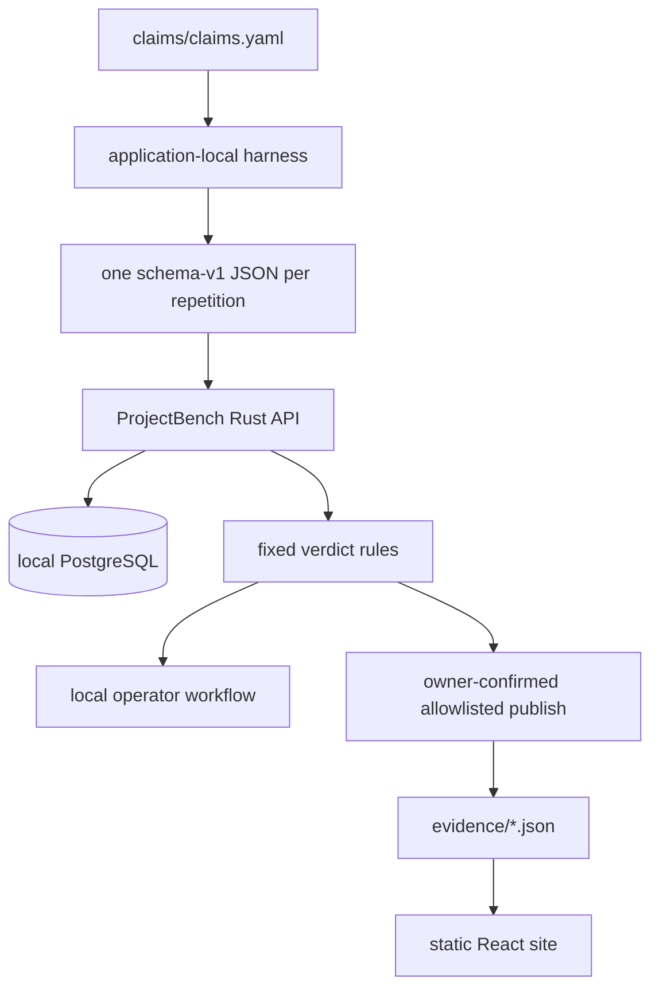

# Architecture

The Rust API loads the bundled claims ledger and persists results in PostgreSQL. Result ingestion validates against both schema v1 and the corresponding claim. Verdict calculation is deterministic. The publish module constructs a separate allowlisted document; it does not serialize the full claim or result records.

The public site is a static React build. It reads `evidence/index.json` and the referenced claim documents. It has no API token and no write control. PostgreSQL and the operator API are for local use only.
