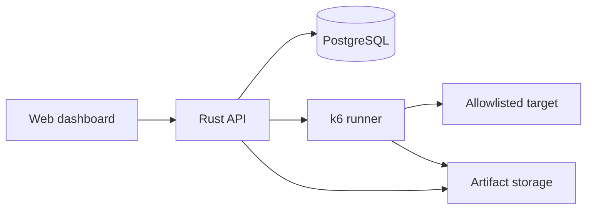

# High-level design

Metrics is a private, self-hostable control plane for reproducible performance evidence. It stores configuration and run metadata; k6 remains the load-generation engine.

Phase 1 uses one API process, one runner process per run, PostgreSQL, and filesystem artifacts. The runner boundary allows later movement to a container or worker without changing domain semantics. A broker and time-series database are intentionally deferred.

Synthetic run samples, real-user telemetry, infrastructure telemetry, and AI events are distinct streams. They can be correlated by explicit project/environment/time/trace identifiers, but are never silently combined.

